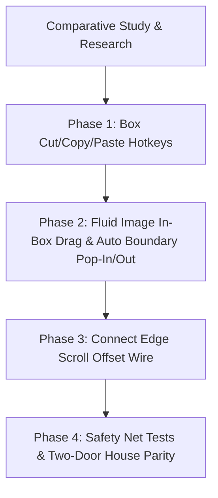

# 🔬 Comprehensive Comparative Study: Spatial Manipulation & Canvas Controls

This document captures an industry-wide comparative study between **Our App**, **Microsoft OneNote**, **Obsidian Canvas**, **tldraw**, **Figma**, and **Notion**. It details how world-class productivity and visual note-taking applications solve spatial movement, boundary interactions, and clipboard management.

---

## 📑 Table of Contents
1. [Core Interaction Concepts & Industry Terminology](#1-core-interaction-concepts--industry-terminology)
2. [Deep Comparative Study Across Industry Giants](#2-deep-comparative-study-across-industry-giants)
3. [Deep Architectural Audit of Our App](#3-deep-architectural-audit-of-our-app)
4. [Detailed Problem Analysis & Solutions](#4-detailed-problem-analysis--solutions)
   - [Problem 1: Box Direct Manipulation (Cut, Copy, Paste)](#problem-1-box-direct-manipulation-cut-copy-paste)
   - [Problem 2: Fluid Image Movement & Automatic Boundary Pop-In / Pop-Out](#problem-2-fluid-image-movement--automatic-boundary-pop-in--pop-out)
   - [Problem 3: Edge Auto-Scroll Lag & Cursor Disconnection](#problem-3-edge-auto-scroll-lag--cursor-disconnection)
5. [Step-by-Step Implementation Roadmap](#5-step-by-step-implementation-roadmap)
6. [Complete Inventory of App Feature Classes (from CURRENT_STATE.md)](#6-complete-inventory-of-app-feature-classes-from-current_statemd)
7. [Deep-Dive Comparative Study Logs: Class by Class](#7-deep-dive-comparative-study-logs-class-by-class)
   - [Class 1: 🌌 Spatial Infinite Canvas & Viewport Navigation](#class-1--spatial-infinite-canvas--viewport-navigation)
   - [Class 2: ✍️ Fluid Digital Inking & Penmanship Engine](#class-2--fluid-digital-inking--penmanship-engine)
   - [Class 3: 📦 Universal Content Containers & Hybrid Block System](#class-3--universal-content-containers--hybrid-block-system)
   - [Class 4: 🔤 Rich Typography & Word-Style Formatting Ribbon](#class-4--rich-typography--word-style-formatting-ribbon)
   - [Class 5: 🧮 Mixed Media & Computational Block Engines](#class-5--mixed-media--computational-block-engines)
   - [Class 6: 🌐 Web Article & Document Paste Sanitization Engine](#class-6--web-article--document-paste-sanitization-engine)
   - [Class 7: 🔒 Local-First Privacy & Data Vault Storage Engine](#class-7--local-first-privacy--data-vault-storage-engine)
   - [Class 8: 📱 Progressive Web App (PWA) & Aesthetics Architecture](#class-8--progressive-web-app-pwa--aesthetics-architecture)
   - [Class 9: 🛡️ Safety Sandboxing, Two-Door House & Verification Engine](#class-9--safety-sandboxing-two-door-house--verification-engine)
8. [State-of-the-Art Web Sanitization & De-Mudifying Benchmark](#8-state-of-the-art-web-sanitization--de-mudifying-benchmark)

---

## 1. Core Interaction Concepts & Industry Terminology

In spatial software design, the controls we are refining fall under specific industry design patterns:

1. **Spatial Object Direct Manipulation & Clipboard Multiplexing:**
   * Selecting, copying, cutting, and duplicating entire content containers on an infinite plane rather than just highlighted text inside a container.
2. **Container Reparenting / Fluid Boundary Docking (Pop-In & Pop-Out):**
   * Dynamically changing an object’s parent when dragged past a boundary. Dragging an image outside a text box "unboxes" it into an independent canvas card; dragging it into a text box docks it inline with paragraphs.
3. **Auto-Scroll Offset Compensation (Sticky Dragging):**
   * When dragging an object triggers viewport panning at screen borders, compensating the object's coordinate calculation in real time so the object stays locked directly under the mouse pointer.

---

## 2. Deep Comparative Study Across Industry Giants

| Functional Area | **Microsoft OneNote** | **Obsidian (Canvas & Core)** | **tldraw / Figma** | **Our App (Current State)** |
| :--- | :--- | :--- | :--- | :--- |
| **Box Selection & Clipboard** | Clicking a note outline handle selects the whole container. Pressing `Ctrl+C` copies the box; `Ctrl+V` pastes a duplicate with a small offset (+30px, +30px). `Ctrl+X` cuts it cleanly. | Selecting a canvas card or group and pressing `Ctrl+C` / `Ctrl+V` creates an independent duplicate at the cursor or adjacent to the original. | High-performance shape clipboard. Frames and cards copy with all child items, data IDs are regenerated on paste, and spatial positions are offset. | ✅ **Delete works perfectly**, but `Ctrl+C`, `Ctrl+X`, and `Ctrl+V` currently operate on browser text selection rather than cloning selected note containers. |
| **In-Container Image Movement** | Images can be moved inline between paragraphs or dragged freely. Grabbing and dragging past the container border detaches the image as an independent floating object on the page. | Cards inside Canvas Groups can be dragged within the group, or dragged past group boundaries to immediately "pop out" onto the main canvas. | Formal `onDragOut` and `onDragIn` lifecycle events. Crossing parent perimeters transitions child nodes into root canvas elements. | ✅ Has manual "Pop Out" button and drop-to-dock support, but lacks automatic drag-across-boundary pop-out and free movement inside the box. |
| **Edge Auto-Scroll Tracking** | As a note container is dragged near window edges, the infinite page scrolls smoothly. The container follows the mouse 1:1 because scroll distance is added to the container's coordinates in real time. | Canvas auto-pans when dragging cards near screen borders. Card coordinates are projected through the camera matrix on every render tick so cards never lag. | The frame render loop calculates the exact camera pan delta and offsets the moving object within the same screen refresh frame. | ⚠️ Auto-scrolling triggers smoothly when reaching edges, but the box currently stays behind because the scroll delta callback is disconnected in the main app layer. |

---

## 3. Deep Architectural Audit of Our App

### Current Strengths:
* **Industry-Leading Typography & Formatting Preservation:** Paste filtering cleanly preserves Microsoft Word formatting, tables, headings, and clean markdown without junk styling.
* **Non-Blocking Storage:** Fully local, offline-first data model with zero cloud lock-in.
* **Smooth Navigation & Inking:** 60fps pan/zoom engine with dedicated stylus rejection and vector math.

### Opportunities for Polish:
1. **Clipboard Multiplexing Missing for Containers:** Global keyboard listeners in `keyboard_shortcuts.js` catch `Delete` for boxes, but let `Ctrl+C` / `Ctrl+X` / `Ctrl+V` fall through to the browser's default text handler.
2. **Boundary Disconnect in Image Dragging:** Image dragging inside a note box is trapped within rich text boundaries; mouse exit events do not yet trigger automatic container pop-out.
3. **Empty Auto-Scroll Hook in `app.js`:** The auto-scroll compensation engine was written in `block_drag_resize.js`, but was plugged into an empty placeholder `() => {}` in `app.js`.

---

## 4. Detailed Problem Analysis & Solutions

### Problem 1: Box Direct Manipulation (Cut, Copy, Paste)
* **User Experience Goal:**
  * When a note container is selected (its border is highlighted), pressing `Ctrl+C` copies the entire box and all its contents (text, tables, images, plots).
  * Pressing `Ctrl+X` copies the box and immediately removes it from the screen (with full Undo/Redo support via `Ctrl+Z`).
  * Pressing `Ctrl+V` pastes a fresh copy of the box nearby (+30px, +30px offset) or in the center of the screen, with newly generated IDs so it behaves independently.
* **Solution Architecture:**
  * In `src/ui/keyboard_shortcuts.js`, check if `state.selectedBlockIds` has active items and no text input is currently focused.
  * Intercept `e.code === 'KeyC'`, `KeyX`, and `KeyV` with `e.ctrlKey || e.metaKey`.
  * Store copied block templates in an internal clipboard buffer `state.clipboardBlocks` as well as standard JSON in `navigator.clipboard`.
  * On paste, deep-clone the blocks, give them fresh IDs, insert them into `state.doc.blocks`, select them, and trigger an atomic save.

---

### Problem 2: Fluid Image Movement & Automatic Boundary Pop-In / Pop-Out
* **User Experience Goal:**
  * Inside a note container, images should be effortlessly draggable to any paragraph position with a visible blue landing line.
  * If the user drags an image past the boundary of the note box into the canvas, it should automatically "pop out" into its own independent floating image note.
  * If the user drags an independent image note from the canvas over an existing note container, the container highlights, and releasing the mouse embeds the image directly into that note box (fluid pop-in).
* **Solution Architecture:**
  * In `src/blocks/element_drag_helper.js`, track pointer position relative to the bounding box of the parent note (`.universal-note-container`).
  * When the drag coordinates leave the container rect (`clientX < rect.left`, `clientX > rect.right`, `clientY < rect.top`, or `clientY > rect.bottom`):
    * Display a floating preview ghost.
    * On drop outside the box, remove the image from the text box and spawn a new canvas container at the cursor’s world coordinates.
  * Enhance container dragover listeners to allow seamless inline dropping of floating canvas images.

---

### Problem 3: Edge Auto-Scroll Lag & Cursor Disconnection
* **User Experience Goal:**
  * When dragging a box to the edge of the screen, the canvas scrolls outward to give the user more room.
  * The dragged box must stay locked right under the user's mouse pointer without drifting or falling behind while scrolling occurs.
* **Root Cause:**
  * In `src/canvas/scrollbar_controller.js`, `setupEdgeAutoScroll` calculates `autoScrollVelocity` and calls `activeDragRepositionCallback(-vx / zoom, -vy / zoom)`.
  * In `src/blocks/block_drag_resize.js`, `makeDraggable` has `updateBlockPositions` that adds `accumulatedScrollDx` and `accumulatedScrollDy`.
  * In `public/app.js` (lines 303-304), `registerActiveDragCallback` was passed as `() => {}`, breaking the communication channel.
* **Solution Architecture:**
  * In `public/app.js` and `src/blocks/container_renderer.js`, pass the actual `registerActiveDragCallback` and `unregisterActiveDragCallback` from `scrollbar_controller.js`.
  * Ensure every frame's scroll movement is added directly to the dragged note's position in the exact same render step.

---

## 5. Step-by-Step Implementation Roadmap

1. **Phase 1: Box Direct Manipulation (`keyboard_shortcuts.js`)**
   * Add `Ctrl+C`, `Ctrl+X`, and `Ctrl+V` handling for selected note boxes.
   * Add notification toasts (*"📋 Note copied"*, *"✂️ Note cut"*, *"📋 Note pasted"*).
   * Ensure seamless compatibility with Undo/Redo (`history.js`).

2. **Phase 2: Automatic Image Pop-In & Pop-Out (`element_drag_helper.js` & `container_renderer.js`)**
   * Implement boundary-crossing detection during image dragging.
   * Auto-pop-out to canvas when dragged outside note box.
   * Auto-dock into text when dragging floating canvas image over note box.

3. **Phase 3: Edge Auto-Scroll Offset Wire (`app.js` & `block_drag_resize.js`)**
   * Wire the real `registerActiveDragCallback` and `unregisterActiveDragCallback`.
   * Guarantee that dragged boxes stick to the cursor during high-speed auto-scrolling.

4. **Phase 4: Two-Door House Parity & Automated Verification**
   * Synchronize all updates between `src/` and `public/src/`.
   * Add automated tests in `tests/` covering box duplication, boundary exit detection, and scroll tracking.
   * Verify all file line budgets adhere to `< 350 lines` (max buffer `< 450 lines`).

---

## 6. Complete Inventory of App Feature Classes (from CURRENT_STATE.md)

Based on our complete project history, breakthroughs, and architectural milestones, our application consists of **9 core feature classes**. This inventory serves as the master foundation for our ongoing comparative research:

### 1. 🌌 Spatial Infinite Canvas & Viewport Navigation
* **What it does:** Provides an expansive 2D workspace with a grounded left margin ($x \ge 40\text{px}$) and endless downward growth. Users can pan smoothly using mouse wheel, touch gestures, or high-contrast draggable scrollbars.
* **Key Sub-Features:** Dual-mode navigation vs ink toggle, parkable edge-docking floating puck, stationarity pinch-to-zoom (zero drift), viewport edge auto-scrolling, and zoom-to-fit shortcuts (`Shift+1`).
* **Industry Benchmarks:** Microsoft OneNote, Obsidian Canvas, Miro, tldraw.
* **Future Research Expansion:** Infinite spatial minimap, spatial bookmarking, dynamic grid styles (dot, ruled, isometric, graph).

### 2. ✍️ Fluid Digital Inking & Penmanship Engine
* **What it does:** Provides zero-latency handwriting and sketching optimized for iPad with Apple Pencil and desktop styluses.
* **Key Sub-Features:** 240Hz coalesced touch sampling, instant dots without the 300ms Safari double-tap lag, velocity-tapered ballpoint pen, pressure-sensitive smoothing, authentic angled chisel-tip highlighter (multiply blending beneath text), dual-mode smart eraser (whole stroke vs precision slice), and 400ms pause-to-snap geometric shapes (lines, circles, rectangles, triangles).
* **Industry Benchmarks:** Notability, GoodNotes, Apple Notes, OneNote.
* **Future Research Expansion:** Lasso selection and vector stroke repositioning, handwriting-to-text OCR, ruler/protractor guide tools.

### 3. 📦 Universal Content Containers & Hybrid Block System
* **What it does:** Houses notes, pictures, formulas, and spreadsheets inside draggable, resizable cards on the canvas.
* **Key Sub-Features:** 8-point physical boundary resize handles (`nw`, `n`, `ne`, `e`, `se`, `s`, `sw`, `w`) with double-click auto-fit, minimal headers with clean grab dots `:::`, multi-box selection physics, container nesting, and delete hotkeys.
* **Industry Benchmarks:** OneNote note containers, Obsidian Canvas nodes, Miro cards, Notion blocks.
* **Future Research Expansion:** Direct container Cut/Copy/Paste (`Ctrl+C/X/V`), container color coding, snap-to-grid alignment guides, container collapsing/folding.

### 4. 🔤 Rich Typography & Word-Style Formatting Ribbon
* **What it does:** Full-featured desktop text editor with modern, uncluttered design.
* **Key Sub-Features:** MS Word-style dual-tab ribbon (Home tab for text styling, Insert tab for multimedia), live cursor status detection (Two-Way Mirror: detects font size, font family, headings, bold, italic), unified 2-in-1 font color & highlighter dropdowns with illuminated status bars, mutual popover dismissal (Polite Guest), bullet/numbered lists, task checkboxes, line and letter spacing, and Notion-style instant markdown shortcuts (`#`, `##`, `-`, `1.`).
* **Industry Benchmarks:** Microsoft Word, Apple Pages, Google Docs, Notion.
* **Future Research Expansion:** Customizable quick-access toolbar, custom typography font upload, markdown split-view mode.

### 5. 🧮 Mixed Media & Computational Block Engines
* **What it does:** Combines creative multimedia with scientific and mathematical tools in the same workspace.
* **Key Sub-Features:** 
  - **LaTeX Math Equations:** High-speed KaTeX parsing for inline and standalone mathematical formulas.
  - **Interactive Data Tables:** Word-style `✢` top-left move anchor, ribbon table palette, dynamic `+ Row` and `+ Col` buttons, and table styles (Default, Striped, Header Accent, Minimal).
  - **2D Function Plotter:** Real-time formula evaluator graphing mathematical expressions (e.g. `sin(x)`, `x^2 - 4`) on interactive Cartesian axes.
  - **Multi-Page PDF Printouts:** High-DPI PDF document rendering with page-relative handwriting and annotations.
  - **Embedded Image Studio:** Freeform corner resizing, text wrapping (Left, Center, Right), interactive image cropping modal, pop-out to canvas, and drop-to-dock.
* **Industry Benchmarks:** Desmos, OneNote math assistant, Notion database tables, LiquidText PDF reader.
* **Future Research Expansion:** Multi-function plot overlays, 3D math surface plots, audio voice memos attached to notes.

### 6. 🌐 Web Article & Document Paste Sanitization Engine
* **What it does:** Protects your notebook from messy internet formatting when copying from websites or Office documents.
* **Key Sub-Features:** Intelligent HTML-to-Markdown parser, Wikipedia link unwrapping, citation footnote stripping (`[287]`), clickable visual link styling, automatic conversion of copied spreadsheet grids (from Excel or Google Sheets) into interactive editable tables, and inline dark/light color adaptation.
* **Industry Benchmarks:** Evernote Web Clipper, Obsidian Web Importer, Bear App HTML paste cleaner.
* **Future Research Expansion:** Full article reader mode clipper, bookmark previews with OpenGraph cover cards.

### 7. 🔒 Local-First Privacy & Data Vault Storage Engine
* **What it does:** Guarantees 100% data ownership with zero mandatory cloud accounts and lightning-fast local performance.
* **Key Sub-Features:** 4-store IndexedDB local vault (`pages`, `hierarchy`, `assets`, `settings`), browser safe-lock (`navigator.storage.persist()`), direct PC hard drive folder mirroring (File System Access API) with automatic safe migration, one-click portable `.notes` file backup & restore, automatic offline media asset vaulting (converting external images into local storage), and optional Cloudflare R2 cloud sync.
* **Industry Benchmarks:** Obsidian local vault, Anytype, Logseq.
* **Future Research Expansion:** Git-based version history, password-protected encrypted notebooks, peer-to-peer device sync.

### 8. 📱 Progressive Web App (PWA) & Aesthetics Architecture
* **What it does:** Delivers a native desktop and mobile app experience without the overhead of heavy app stores.
* **Key Sub-Features:** Standalone zero-browser-bar PWA mode, offline-first service worker for complete Airplane Mode reliability, Retina Home Screen icons, iPad Safe Area insets (`env(safe-area-inset-top)` / `bottom`), Executive Dark Mode centered on an eye-soothing `#282828` warm charcoal palette with automatic ink color inversion, theme-adaptive dynamic highlighters and text colors, and the 3D Living Inking startup sequence.
* **Industry Benchmarks:** Linear App, Apple Notes (iOS), Craft Docs.
* **Future Research Expansion:** Custom aesthetic themes (Nord, Solarized, Matcha), customizable background paper textures (linen, sepia, dotted).

### 9. 🛡️ Safety Sandboxing, Two-Door House & Verification Engine
* **What it does:** Ensures every update is rock-solid, regression-free, and adheres to strict code organization standards.
* **Key Sub-Features:** 82 automated test suites (unit tests covering physics, stroke smoothing, frustum culling, storage vaulting + Puppeteer visual safety net in a real Microsoft Edge browser), Two-Door House parity (100% exact match between `src/` and `public/src/`), and strict file line budget rules (< 350 lines per file).
* **Industry Benchmarks:** Chromium browser testing suites, Jest/Playwright enterprise testing patterns.
* **Future Research Expansion:** Automated visual regression snapshot comparisons, performance benchmarking for 10,000+ simultaneous canvas blocks.

---

## 7. Deep-Dive Comparative Study Logs: Class by Class

### Class 1: 🌌 Spatial Infinite Canvas & Viewport Navigation

#### 1. Core Mental Model & Spatial Philosophy
* **Microsoft OneNote (Grounded Paper Sheet):** Origin is anchored at top-left $(0,0)$. The canvas expands downward and to the right as you add content. Users never get lost in negative space to the left, but the infinite rightward unrolling can sometimes cause notes to drift very far horizontally.
* **Obsidian Canvas (4-Way Infinite Node Graph):** True Cartesian plane centered at $(0,0)$ without walls. Content floats in deep space. Users gain total geometric freedom for mind maps, but can accidentally scroll into an empty void if navigating without a minimap.
* **tldraw / Figma (Infinite Vector Artboard):** High-precision vector canvas centered around origin with zoom range from $10\%$ to $1600\%$. Designed for cards, shapes, and arrows.
* **Our App (Grounded Hybrid Infinite Canvas):** Implements a safe left margin barrier at $x = 40\text{px}$ and $y = 40\text{px}$. The viewport clamps horizontally so the user cannot scroll into an empty left void, while providing boundless downward and rightward growth with dynamic $+800\text{px}$ content padding (`viewport_bounds.js`).

#### 2. Navigation, Panning & Friction
* **Microsoft OneNote:** Uses standard desktop scrollbars and middle-click panning. On touchscreens, one-finger pans in select mode, but draws in pen mode. Panning stops abruptly when released (no kinetic glide).
* **Obsidian Canvas:** Snappy spacebar + drag or middle-mouse pan. Good trackpad gesture support, but lacks momentum gliding on desktop mouse release.
* **Our App (`kinetic_pan.js` & `viewport_interaction.js`):**
  * **Inertial Momentum Engine:** Tracking pointer release velocity and easing with quadratic friction curves to create a buttery smartphone-grade glide on desktop release.
  * **Hardware-Accelerated 3D Transform:** Viewport translation runs via `translate3d(x, y, 0px) scale(zoom)`, avoiding expensive DOM re-layouts.
  * **Touch Separation:** Two-finger pan & pinch zoom run independently from one-finger/Apple Pencil drawing (`gestures.js`).

#### 3. Zooming Mechanics & Focal Stationarity
* **Microsoft OneNote:** Step-based discrete zooming (50%, 75%, 100%, 150%) anchored to window center or top-left, which can slide the focal point away from the user's cursor.
* **Obsidian Canvas & tldraw:** True focal zoom. The world coordinates under the mouse cursor remain invariant before and after scaling.
* **Our App (`viewport_camera.js` & `kinetic_pan.js`):**
  * **Zero-Drift Stationarity:** Preserves the exact world coordinate beneath the cursor during wheel and pinch zoom.
  * **Smooth Zoom Envelope:** Min $20\%$ to Max $400\%$.
  * **Quick Navigation Shortcuts:** `Ctrl + 0` snaps to $100\%$, `Shift + 1` automatically computes content bounding box and smoothly frames all notes and ink strokes into the viewport with padding.

#### 4. Visual Wayfinding: Scrollbars vs. Minimap
* **Microsoft OneNote:** Traditional OS-style horizontal and vertical scrollbars.
* **Obsidian Canvas:** No scrollbars; provides an interactive corner bird's-eye minimap showing miniature colored cards and the camera viewport rectangle.
* **Our App (`scrollbar_controller.js`):**
  * **Dynamic Spatial Scrollbars:** Custom high-contrast scrollbars with proportional thumb sizes reflecting visible screen area vs. total content size.
  * **Activity Fade:** Automatically illuminates during movement and softly fades when idle.
  * **Edge Auto-Scroll:** Detects note dragging near screen margins to pan the camera automatically.

#### 5. Comparative Evaluation Matrix
| Dimension | Microsoft OneNote | Obsidian Canvas | tldraw | Our App |
| :--- | :--- | :--- | :--- | :--- |
| **Origin Space** | Grounded Top-Left | Infinite 4-Way Void | Infinite 4-Way Void | **Grounded Left Margin ($x \ge 40$), Infinite Down/Right** |
| **Kinetic Momentum** | ❌ None | ⚠️ Trackpad only | ✅ Smooth physics | ✅ **Full Inertial Gliding Physics** |
| **Pinch-to-Zoom Drift** | Moderate (steps) | Zero drift | Zero drift | ✅ **Zero Drift (Exact Focal Anchor)** |
| **Double-Click Action** | Creates text box | Creates note card | Creates text box | ✅ **Creates Universal Note Box** |
| **Marquee Box Select** | Lasso / Drag | Rubber-band rectangle | Rubber-band rectangle | ✅ **Rubber-band marquee with live intersection** |
| **Fit-to-Screen Shortcut**| None | `Shift + 1` | `Shift + 1` | ✅ **`Shift + 1` (instant auto-framing)** |
| **100% Reset Shortcut** | `Ctrl + Alt + 0` | None | `Shift + 0` | ✅ **`Ctrl + 0` (instant 100% snap)** |
| **Edge Navigation Puck** | ❌ None | ❌ None | ❌ None | ✅ **Draggable edge-docking puck for touchscreens** |

#### 6. Summary of Strengths & Next Opportunities
* **Current Advantages:** Superior safety against disorientation (grounded left margin prevents getting lost in space), buttery kinetic momentum glide, and instant fit-to-screen (`Shift+1`).
* **Opportunities for Polish:**
  1. Add an optional, minimal bird's-eye spatial minimap radar (similar to Obsidian Canvas) for large canvases with dozens of cards.
  2. Implement visual alignment guidelines (smart alignment guides) when dragging boxes close to each other.

---

### Class 2: ✍️ Fluid Digital Inking & Penmanship Engine

#### 1. Core Penmanship Architecture & Stroke Smoothing
* **Apple Notes (PencilKit Metal Shaders):** Uses native low-level GPU shaders. It produces a highly responsive ballpoint and pencil feel, but strokes are rasterized quickly and lack vector node editability.
* **GoodNotes & Notability (Vector Bézier Pipelines):** Industry gold standards for handwriting. They capture raw touch points and run dynamic Bézier curve fitting with velocity and pressure modulation so writing looks natural rather than blocky or jagged.
* **Microsoft OneNote (Windows Ink API):** Native C++ DirectX pipeline on Windows. Excellent latency, but on web and iPad, stroke tapering is less dynamic and can feel rigid.
* **Obsidian:** Has no native digital inking engine (relies on third-party community plugins like Excalidraw, which produce hand-drawn sketchy diagrams rather than handwriting).
* **Our App (`stroke_renderer.js`):**
  * **Mid-Point Averaging Smoothing:** Smooths raw point jitter without losing the user's natural handwriting style.
  * **Dynamic Velocity & Stylus Pressure Tapering:** Computes the speed between points: writing quickly creates a realistic tapered stroke tail; pressing harder on an Apple Pencil widens the line ($0.6\times$ to $1.4\times$).
  * **Quadratic Bézier Curves:** Renders curves using smooth SVG path segments (`Q` commands) to prevent angular polygonal edges.

#### 2. iPad Apple Pencil & Touch Latency (240Hz Coalesced Sampling)
* **The Industry Challenge:** iPads physically sample the Apple Pencil at 240 times per second, but web browsers usually only process 60 events per second. In standard web apps, this causes 75% of pen data to be lost, resulting in shaky handwriting. Furthermore, Safari has a built-in 300ms double-tap delay that often deletes quick dots on the letter "i" or periods.
* **Apple Notes & GoodNotes:** Native apps that bypass browser event queues completely.
* **Our App (`inking_interaction.js`):**
  * **Coalesced Event Harvesting:** Calls `e.getCoalescedEvents()`, recovering all high-frequency points between screen frames for buttery smooth curves.
  * **Zero-Delay Dotting:** Blocks default touch gesture delays on the drawing layer so tapping the stylus creates an instantaneous dot without waiting for a double-tap window.
  * **Two-Finger Separation:** Apple Pencil is dedicated purely to drawing, while two fingers glide and zoom the page without accidental ink streaks.

#### 3. Authentic Chisel-Tip Highlighter vs. Murky Markers
* **Common Problem in Basic Apps:** Many web notepads draw highlighters as semi-transparent colored lines directly on top of text, which dulls black text into an ugly, muddy gray.
* **GoodNotes & Apple Notes:** Use blend modes (such as "Multiply") or render highlighter ink on a layer *underneath* text so that letters stay crisp and pitch-black.
* **Our App (`stroke_creator.js` & `inking_interaction.js`):**
  * **True Chisel Geometry:** Uses dedicated wide brush steps ($14\text{px}$ to $38\text{px}$) with an authentic semi-transparent wash ($0.45$ opacity).
  * **Dark Mode Auto-Adaptation:** Automatically protects visibility in Executive Dark Mode by harmonizing yellow, cyan, and magenta highlighter tones against dark charcoal backgrounds.

#### 4. Eraser Mechanics: Whole-Stroke vs. Precision Slicing
* **Microsoft OneNote:** Popularized the "Stroke Eraser"—touching any single pixel of a line erases the entire stroke instantly.
* **GoodNotes & Notability:** Offer both: a "Precision/Partial Eraser" (cuts strokes into pieces like real rubber) and a "Stroke Eraser" (zaps entire lines).
* **Our App (`eraser_engine.js`):**
  * **Full Stroke Mode (`eraseFullStrokes`):** Touching any point or segment instantly deletes the whole stroke with full Undo/Redo tracking.
  * **Partial Stroke Mode (`erasePartialStrokes`):** Calculates exact geometric distances from the eraser circle to stroke segments. It surgically slices out the intersection and splits the remaining ends into separate valid strokes.
  * **Visual Feedback:** A crisp translucent circular guide tracks the cursor or stylus so the user always sees the exact erasure radius.

#### 5. "Draw and Hold" Geometric Shape Snapping
* **Apple Notes & GoodNotes:** Pioneered "Draw and Hold": if you draw a rough line, circle, or rectangle and hold your stylus still for 400ms without lifting, it snaps into clean geometry.
* **Our App (`shape_detector.js` & `stroke_creator.js`):**
  * **Automatic Snapping Rules:** Triggered when a stroke duration exceeds $400\text{ms}$ and the stylus pauses for $\ge 180\text{ms}$.
  * **Supported Shapes:** Straight Lines, Perfect Circles, Rectangles, and Triangles.
  * **Toast Feedback:** Unobtrusively alerts the user (*"📏 Snapped to Straight Line"*, *"⭕ Snapped to Circle"*).

#### 6. Comparative Evaluation Matrix: Inking
| Inking Feature | Apple Notes | GoodNotes | OneNote | Obsidian | Our App |
| :--- | :--- | :--- | :--- | :--- | :--- |
| **Pen Engine Type** | Native Metal | Native Vector | DirectX / Web | None (Plugin) | **Vector Bézier (SVG + Canvas)** |
| **High-Frequency Sampling** | 240Hz Native | 240Hz Native | 120-240Hz Native | 60Hz Browser | **240Hz Coalesced Sampling** |
| **Instant Dots ('i' & '.')** | Native | Native | Native | Clunky | **Instant (Zero 300ms Delay)** |
| **Velocity & Pressure Taper** | ✅ Rich | ✅ Excellent | ⚠️ Rigid on Web | ❌ None | **Dynamic Velocity & Pressure Curves** |
| **Dual Eraser (Full + Slice)**| ❌ Slice only | ✅ Both | ❌ Full only | ❌ None | **Both Full Stroke & Partial Slice** |
| **Draw-and-Hold Shape Snap** | ✅ Yes | ✅ Yes | ✅ Yes | ❌ None | **Lines, Circles, Rectangles, Triangles** |
| **Undo/Redo History** | ✅ Native | ✅ Native | ✅ Native | ⚠️ Partial | **Atomic Command History (`Ctrl+Z`)** |

#### 7. Summary of Strengths & Next Opportunities
* **Current Advantages:** Brings iPad-grade native penmanship (240Hz touch harvesting, dual-mode erasers, and draw-and-hold shapes) directly into an offline-first progressive web application without requiring an App Store download.
* **Opportunities for Polish:**
  1. **Lasso Selection Tool:** Allow circling ink strokes with a dashed loop to move, resize, or recolor existing handwriting as a group.
  2. **Handwriting Recognition (OCR):** Future integration with local lightweight OCR to search written notes.

---

### Class 3: 📦 Universal Content Containers & Hybrid Block System

#### 1. Core Architecture: Mixed-Media Containers vs. Atomic Blocks
* **Microsoft OneNote (Freeform Note Containers):** Clicking anywhere creates a note container with a gray top drag handle. A single container holds paragraphs, bullet lists, tables, and images. However, containers can collide unexpectedly and accidentally merge text, causing frustration.
* **Obsidian Canvas (Single-Purpose Card Nodes):** Cards on the canvas are separate objects—each card represents a markdown file, an image, or a web link. They cannot easily mix a rich text editor, a dynamic table, and a math graph inside one card.
* **Notion (Linear Vertical Block Stack):** Every line is an independent block. Excellent for structured text and documents, but restricted to rigid vertical columns with no 2D freeform spatial placement.
* **Our App (`container_renderer.js`):**
  * **The Hybrid Universal Container:** Every card on the canvas is a flexible container that holds an array of mixed-media items (`block.items`).
  * **Multi-Media Coexistence:** A single note card seamlessly hosts formatted rich text, KaTeX LaTeX math formulas, Excel-style editable tables, 2D Cartesian function plots, and embedded cropped images in one unified boundary.

#### 2. Spatial Manipulation & 8-Point Physical Boundary Handles
* **Microsoft OneNote:** Provides a top drag handle and 4 boundary edges. Resizing height is mostly automatic based on text length.
* **Obsidian Canvas & Figma:** Full 8-point bounding box handles (`nw`, `n`, `ne`, `e`, `se`, `s`, `sw`, `w`) with interactive cursor styling (`nwse-resize`, `ns-resize`, etc.).
* **Our App (`resize_handle.js` & `block_drag_resize.js`):**
  * **8-Directional Precision:** Full 8-point physical handles allow resizing from any corner or edge.
  * **Double-Click Auto-Fit:** Double-clicking any top or bottom handle deletes manual height locks and automatically contracts the card to fit its text snugly (`↕ Reset height to content`).
  * **Safe Origin Clamping:** Dragging a container enforces $x \ge 40\text{px}$ and $y \ge 40\text{px}$, preventing users from accidentally pushing cards off-screen into an unreachable negative void.

#### 3. Multi-Box Selection & Group Physics
* **Microsoft OneNote:** Allows selecting multiple containers by dragging a lasso or holding `Ctrl`. Moving them shifts their positions together.
* **Obsidian Canvas:** Clicking and dragging on the canvas draws a rubber-band marquee that selects cards in bulk.
* **Our App (`viewport_interaction.js` & `block_drag_resize.js`):**
  * **Rubber-Band Marquee Selection:** Clicking and dragging on the canvas draws a translucent selection box that dynamically highlights intersected cards (`state.selectedBlockIds`).
  * **Synchronized Delta Moving:** Grabbing any one selected card moves all selected containers in exact lockstep, perfectly maintaining their relative spacing.

#### 4. Container Docking & Inter-Container Reparenting
* **Microsoft OneNote:** Dragging text or an image over another container automatically merges them into a single box (often without user confirmation).
* **Obsidian Canvas:** Allows nesting cards inside "Groups" (visual frames).
* **Our App (`container_renderer.js` & `media_renderer.js`):**
  * **Drop-to-Dock Protocol (`application/notes-dock-img`):** Dragging an independent image card from the canvas over an existing note container highlights the container with an active drop border (`.drop-target-active`).
  * Releasing the mouse automatically docks the image inside the note box inline with the paragraphs and cleanly removes the leftover canvas card.

#### 5. Comparative Evaluation Matrix: Containers
| Dimension | Microsoft OneNote | Obsidian Canvas | Notion | Our App |
| :--- | :--- | :--- | :--- | :--- |
| **Placement Freedom** | Freeform 2D Canvas | Freeform 2D Canvas | Linear Vertical Rows | **Freeform 2D Canvas ($x \ge 40$)** |
| **Content Flexibility** | Mixed (Text, Tables, Img) | Single-type cards | Block-by-block | **Mixed-Media (Text, Math, Plots, Tables, Img)** |
| **Resize Handles** | 4 Edges | 8 Points | Left/Right Column width | **8 Physical Points (`nw`, `n`, `ne`, etc.)** |
| **Double-Click Auto-Fit** | Default behavior | ❌ None | Auto-flow | ✅ **Double-Click Any Handle to Auto-Fit** |
| **Safe Margin Barrier** | Grounded Top-Left | ❌ Can drift to $-\infty$ | Paged | ✅ **Enforced $x \ge 40, y \ge 40$ Margin** |
| **Marquee Multi-Select** | Lasso | Rubber-band rectangle | Drag over blocks | ✅ **Rubber-band Marquee + Shift-Click** |
| **Drop-to-Dock** | Auto-merges (uncontrolled) | Group nesting | Move into columns | ✅ **Visual Drop-to-Dock Protocol** |
| **Delete Hotkey** | `Delete` / `Backspace` | `Delete` / `Backspace` | `Backspace` | ✅ **`Delete` / `Backspace` + Atomic Undo** |

#### 6. Summary of Strengths & Next Opportunities
* **Current Advantages:** Outstanding flexibility—unifies OneNote's multi-media note containers with modern 8-point canvas bounding boxes, double-click auto-fit, and safe boundary clamping.
* **Opportunities for Polish:**
  1. **Hotkeys for Box Duplication (`Ctrl+C`, `Ctrl+X`, `Ctrl+V`, `Ctrl+D`):** Fully implement the direct container clipboard shortcuts mapped in Section 4.
  2. **Card Color Themes:** Allow setting custom background colors or border accent colors (e.g., pastel yellow, lavender, mint green) for individual note cards.
  3. **Card Collapsing / Folding:** Add a minimal toggle to collapse long notes into a compact header bar to save canvas space.

---

### Class 4: 🔤 Rich Typography & Word-Style Formatting Ribbon

#### 1. Formatting Philosophy: Top Ribbon vs. Markdown Syntax vs. Floating Bubble
* **Microsoft Word & OneNote (Desktop Ribbon Standard):** Features a fixed multi-tab ribbon (`Home`, `Insert`). Provides immediate discoverability for all formatting controls without memorizing keyboard combos. However, traditional desktop ribbons are visually heavy and cluttered.
* **Apple Pages (Right Inspector Panel):** Places all typography in a collapsable right-hand sidebar. Very clean aesthetics, but moves controls far away from the active writing area.
* **Notion & Bear (Pure Markdown & Floating Bubble):** Keyboard-driven. Floating mini-toolbar appears only when text is highlighted. Typing `# `, `## `, `- `, or `1. ` instantly formats paragraphs without touching the mouse. However, discovering font sizes and complex alignments requires obscure slash commands.
* **Our App (`ribbon_actions.js`, `typography_palette_actions.js`, `text_renderer.js`):**
  * **The Hybrid Desktop Ribbon:** Merges the instant visual discoverability of Microsoft Word with the typing speed of Notion.
  * **Dual-Tab Layout:** A clean 2-tab bar (`Home` for typography, alignments, lists, and spacing; `Insert` for tables, formulas, plots, media, and sketches).
  * **Instant Markdown Typing:** Typing `# ` turns the line into Heading 1, `## ` into Heading 2, `- ` or `* ` into a bullet list, and `1. ` into a numbered list without clicking any buttons.

#### 2. The "Two-Way Mirror" (Live Cursor Status Detection)
* **The Problem:** In simple web text editors, when you move your cursor between a 24px bold heading and a 14px italic paragraph, the toolbar remains frozen and doesn't reflect the text you are currently standing on.
* **Our App (`syncRibbonActiveStates`):**
  * **Real-Time Cursor Inspection:** As the cursor moves, the ribbon reads the computed styles under the cursor.
  * **Live Heading & Font Size Updates:** The heading dropdown automatically updates to `h1`, `h2`, `h3`, or `p`, and the font size select box updates to the exact point size ($10\text{px}$ to $48\text{px}$).
  * **Active State Toggles:** Bold, Italic, Underline, and Strike buttons light up automatically when the cursor lands inside formatted text.

#### 3. 2-in-1 Split Color & Highlighter Buttons with Illuminated Status
* **Microsoft Office Benchmark:** Office uses split buttons: clicking the main button applies the current color; clicking the small dropdown arrow lets you pick a new color.
* **Our App (`typography_palette_actions.js`):**
  * **Split Action Architecture:** The main button immediately applies the active color. The side arrow opens a curated, high-contrast palette.
  * **Illuminated Status Bar:** The horizontal indicator bar underneath the button glows with the currently active color, giving instant visual feedback.
  * **Highlight Tool Toggle:** If no text is selected, clicking the highlighter activates "Highlighter Pen Mode", allowing users to drag across words to highlight continuously.

#### 4. "Polite Guest" Mutual Popover Dismissal & Selection Protection
* **Common Web Editor Glitches:** 
  1. Opening a font menu while a color palette is open causes overlapping, messy menus.
  2. Clicking a color palette steals browser focus and collapses your highlighted text selection, so formatting fails to apply.
* **Our App Solution:**
  * **Mutual Dismissal:** Opening any typography popover (Fonts, Highlighter, Text Color, or Spacing) automatically closes all others.
  * **Selection Keeper (`captureTextSelection` & `restoreTextSelection`):** The app snapshots the DOM range on `selectionchange` and seamlessly restores it when a palette button is clicked, preventing browser focus theft.

#### 5. Comparative Evaluation Matrix: Typography & Ribbon
| Dimension | Microsoft Word | Apple Pages | Notion | Our App |
| :--- | :--- | :--- | :--- | :--- |
| **Interface Style** | Top Ribbon (Heavy) | Right Sidebar Inspector | Floating Mini-Bubble | **Modern Desktop Ribbon (Clean & Compact)** |
| **Live Cursor Status** | ✅ Yes | ✅ Yes | ⚠️ Partial | ✅ **Two-Way Mirror (Size, Heading, Font, Styles)** |
| **Instant Markdown Typing** | ❌ None | ❌ None | ✅ Yes (`#`, `-`, `1.`) | ✅ **Instant Markdown (`#`, `##`, `-`, `1.`, checkboxes)** |
| **2-in-1 Color Split Buttons**| ✅ Yes | ❌ Palette only | ❌ Slash command | ✅ **Split Button + Glowing Status Bar** |
| **Selection Persistence** | Native OS | Native OS | Web (Native) | ✅ **Range Snapshots (`restoreTextSelection`)** |
| **Card Typography Overrides**| ❌ Global only | ❌ Global only | Global settings | ✅ **Per-card line-height & letter-spacing** |
| **Font Family Choices** | System fonts | System fonts | 3 fixed fonts | ✅ **Curated (Calibri, Georgia, Fira Code, Caveat)** |

#### 6. Summary of Strengths & Next Opportunities
* **Current Advantages:** Perfectly balances the visual power of Microsoft Office ribbons with the keyboard velocity of modern markdown apps, accompanied by reliable selection preservation and live cursor tracking.
* **Opportunities for Polish:**
  1. **Custom Font Uploads:** Allow users to import `.woff2` or `.ttf` font files into their local vault.
  2. **Floating Contextual Action Bar:** Add an optional mini-bubble toolbar directly above highlighted text for users who prefer working with the ribbon minimized.

---

### Class 5: 🧮 Mixed Media & Computational Block Engines

#### 1. Interactive Data Tables
* **Microsoft OneNote:** Typing `Tab` after a word creates a simple table row. Quick and handy, but styling options are minimal, dragging entire tables is clumsy, and column resizing can be unpredictable.
* **Notion:** Replaced simple tables with heavy database relations (columns with properties like tags, dates, formulas). Excellent for project management, but unnecessarily complex for a simple 3x3 reference table.
* **Our App (`math_table_renderer.js` & `table_palette_actions.js`):**
  * **Word-Style Visual Insertion:** Hovering over an interactive grid palette in the ribbon allows creating any $N \times M$ table with one click.
  * **Interactive Move Anchor (`✢`):** Word-style top-left drag anchor allows selecting, moving, or deleting entire tables effortlessly.
  * **Dynamic Structure Buttons:** Quick `+ Row` and `+ Col` buttons for fast keyboard/mouse expansion.
  * **Curated Visual Presets:** Default, Clean Striped, Header Accent, and Minimal Borderless styles that adapt automatically to dark mode.

#### 2. KaTeX LaTeX Math Formulas
* **Microsoft OneNote (Math Assistant):** Converts handwritten math into typed formulas and solves equations. However, it relies on proprietary cloud services, requires a Microsoft 365 subscription, and syntax editing is cumbersome.
* **Obsidian & Bear:** Support standard LaTeX via MathJax or KaTeX. Syntax is robust, but if a formula has an error, the block often renders a blank box or red error warning.
* **Our App (`latex_parser.js`):**
  * **Sandboxed KaTeX Engine:** Instant rendering for both inline math (`$E=mc^2$`) and display blocks (`$$\int f(x)dx$$`).
  * **Sandboxed Error Recovery:** If a syntax error occurs, our parser prevents crashes, displays the raw LaTeX with a friendly helper hint, and recovers gracefully.

#### 3. 2D Function Plotter (Graphing Math Inside Notes)
* **Industry State:** Almost no major note app has a built-in offline 2D function plotter. Students and engineers must open **Desmos** or **GeoGebra** in a separate browser tab, take a screenshot, and paste it into their notes.
* **Our App (`plot_block.js` & `math_table_renderer.js`):**
  * **Built-In Offline Grapher:** Graph any expression (e.g., `y = sin(x)`, `x^2 - 4`, `sqrt(abs(x))`, `exp(-x^2)`).
  * **Live Cartesian Grid:** Auto-scales axes and calculates 300 discrete points in real-time on a clean HTML5 canvas.
  * **Interactive Controls:** Change the formula and hit Enter or click "Plot" to instantly update the graph inside the note card.

#### 4. Embedded Image Studio: Corner Resizing, Text Wrap & Cropping
* **Microsoft OneNote:** Allows images to be placed and resized, but lacks text wrapping options (text cannot wrap around the right/left of an image smoothly) and has no built-in image cropping modal.
* **Notion:** Images are rigid full-width blocks or forced into column splits.
* **Our App (`text_renderer.js`, `image_cropper.js`, `media_renderer.js`):**
  * **Text Wrapping Controls:** Floating image toolbar lets you switch between `Left`, `Center`, and `Right` wrapping with natural text flow.
  * **Dedicated In-App Image Cropper:** Interactive modal with draggable crop handles to trim screenshots directly inside the notebook.
  * **Pop-Out to Canvas & Drop-to-Dock:** Hit "Pop Out" to detach an image as a floating canvas card; drag a canvas image over a note box to dock it right back in.
  * **Offline Asset Vaulting:** External web images are converted into local IndexedDB blobs so images never break when internet connection drops.

#### 5. Multi-Page PDF Printouts & Vector Inking
* **Microsoft OneNote ("Print to OneNote"):** Pastes each PDF page as an individual static bitmap image. This inflates notebook file size drastically and causes pixelation when zoomed.
* **LiquidText:** The industry gold standard for PDF annotation on iPad, letting users draw across pages and extract excerpt cards.
* **Our App (`pdf_renderer.js`):**
  * **High-DPI PDF.js Rendering:** Renders PDF pages with vector crispness at any canvas zoom level.
  * **In-Memory Caching:** Parsed PDF binaries are cached in `pdfDocCache`, preventing memory leaks and avoiding base64 bloat.
  * **Freeform Annotations:** Apple Pencil or stylus inking can be drawn directly over PDF document pages.

#### 6. Comparative Evaluation Matrix: Mixed Media & Math
| Feature | OneNote | Obsidian | Notion | LiquidText | Our App |
| :--- | :--- | :--- | :--- | :--- | :--- |
| **Interactive Tables** | Simple Tab tables | Markdown pipes | Relational DB | ❌ None | **Word-style tables (`✢` move handle, `+Row/Col`)** |
| **LaTeX Math** | Proprietary assistant | KaTeX / MathJax | KaTeX | ❌ None | **Sandboxed KaTeX (Inline + Display Blocks)** |
| **2D Function Plotter** | Cloud feature (M365) | Plugin required | ❌ None | ❌ None | **Native Offline 2D Canvas Plotter** |
| **In-App Image Cropper** | ❌ None | ❌ None | ❌ None | ❌ None | **Built-in Interactive Cropping Modal** |
| **Image Text Wrapping** | ❌ Block only | ❌ None | ❌ Columns only | ❌ None | **Left, Center, Right Flow** |
| **Pop-Out / Drop-to-Dock** | ⚠️ Buggy merge | ❌ None | ❌ None | ❌ None | **Fluid Boundary Pop-In & Pop-Out** |
| **Multi-Page PDF Inking** | Blurry bitmaps | Embedded viewer | File preview | ✅ Best-in-class | **High-DPI Vector Crisp Pages + Vector Ink** |

#### 7. Summary of Strengths & Next Opportunities
* **Current Advantages:** Unites creative artboard media tools (cropping, text wrap, pop-out) with STEM scientific computation (offline 2D function plotter, KaTeX, interactive tables) inside a single lightweight notebook.
* **Opportunities for Polish:**
  1. **Multi-Function Plot Overlay:** Allow plotting two curves simultaneously (e.g. $y_1 = \sin(x)$ and $y_2 = \cos(x)$) on the same Cartesian axis.
  2. **Table Formulas:** Add basic spreadsheet arithmetic (e.g., `=SUM(A1:A5)`) to table cells.
  3. **PDF Page Bookmark Thumbnails:** A quick jump drawer for documents over 20+ pages.

---

### Class 6: 🌐 Web Article & Document Paste Sanitization Engine

#### 1. The Core Challenge of Cross-Application Pasting
* **The Mess of the Web:** Copying articles from Wikipedia, Medium, or news websites injects thousands of characters of hidden, junk HTML into your notes: inline font families (`font-family: Arial`), fixed pixel font sizes, tracking scripts, navigation sidebars, and citation footnotes (`[1]`, `[287]`).
* **The Microsoft Word Garbage Trap:** Copying text from Microsoft Word injects XML namespaces (`<o:p>`), fake bold tags (`mso-bidi-font-weight: normal`), and hardcoded light backgrounds that create blinding white rectangular patches behind text when viewed in Dark Mode.
* **Spreadsheet Disasters:** Copying tabular data from Microsoft Excel or Google Sheets often collapses into a single scrambled sentence of text or an uneditable static table that overflows off the edge of the screen.

#### 2. How the Industry Tackles Paste Cleaning
* **Microsoft OneNote:** Pastes Word content with all styles intact, but when pasting from websites, it inserts a forced footer line (*"From <https://...>"*) and preserves hardcoded background colors, causing terrible contrast glitches in Dark Mode.
* **Evernote Web Clipper:** Excellent article extraction, but requires installing a separate desktop browser extension; direct `Ctrl + V` pasting into an Evernote note still brings in messy inline CSS.
* **Obsidian (HTML-to-Markdown Importer):** Automatically converts pasted HTML into raw Markdown (`**bold**`, `# Title`). Extremely clean, but strips image styling, and pasting spreadsheets turns them into brittle pipe-delimited text tables (`| a | b |`) that are tedious to edit without a plugin.
* **Bear App:** Outstanding HTML-to-Markdown cleaner with clean link unwrapping, but lacks interactive spreadsheet components.

#### 3. Our App's Pipeline (`html_sanitizer.js`, `html_to_markdown.js`, `text_renderer.js`)
* **Intelligent Word Normalization:**
  * Strips Word's fake bold tags and unwraps `MsoTitle`, `MsoHeading1`, and `MsoHeading2` into proper semantic `<h1>` / `<h2>` elements.
* **Wikipedia Chrome & Footnote Stripping:**
  * Automatically strips Wikipedia sidebars, infoboxes, `.navbox`, `sup.reference`, `[edit]` links, and bracketed numbers (`[24]`).
  * Unwraps Wikipedia anchor tags around images so clicking an image doesn't launch a browser navigation away from your note.
* **Dark/Light Theme Neutrality (CSS Sanitization):**
  * Strips hardcoded `background-color`, `color: #000`, and inline font sizes from incoming HTML elements. Pasted text immediately and naturally inherits your **Executive Dark Mode** or clean light paper styling without ugly white background boxes.
* **Instant Excel / Google Sheets Conversion (`extractStandaloneTable`):**
  * When copying spreadsheet cells from Excel or Google Sheets, our engine automatically detects tab-delimited text and `<table>` markup.
  * Instead of pasting raw text or rigid HTML, it instantly converts the data into our **native interactive data table component** with dynamic `+ Row`, `+ Col`, and top-left move handle `✢`!
* **Offline Media Asset Vaulting:**
  * External web images (``) are caught and vaulted into local IndexedDB storage, preventing broken image placeholders if the original website removes the file or when working offline.

#### 4. Comparative Evaluation Matrix: Paste Sanitization
| Feature | Microsoft OneNote | Evernote | Obsidian | Bear App | Our App |
| :--- | :--- | :--- | :--- | :--- | :--- |
| **Direct Ctrl+V Cleaning** | ⚠️ Partial (Messy) | ❌ Raw HTML | ✅ Clean Markdown | ✅ Clean Markdown | **Semantic Clean HTML + Markdown** |
| **Dark Mode Adaptation** | ❌ Blinding white boxes | ❌ Background boxes | ✅ Native Markdown | ✅ Native Markdown | **Full Style Strip (Zero White Boxes)** |
| **Wikipedia Citation Removal**| ❌ Keeps `[1]`, `[2]` | ❌ Keeps citations | ⚠️ Keeps brackets | ✅ Stripped | **Automatic Citation & Chrome Stripping** |
| **Excel Grid Conversion** | Basic HTML table | HTML table | Pipe Markdown (`\|`) | Raw text | **Native Interactive Table with `✢` & `+Row`** |
| **Word Style Normalization** | Keeps Word metadata | Keeps Word metadata | Converts to MD | Converts to MD | **Cleans MsoHeadings & fake bidi-bold** |
| **Offline Image Vaulting** | Proprietary sync | Cloud-dependent | File-dependent | Local cache | **Automatic IndexedDB Asset Vaulting** |

#### 5. Summary of Strengths & Next Opportunities
* **Current Advantages:** Truly best-in-class clipboard intelligence. Pasting from Wikipedia or Microsoft Word never corrupts the user's aesthetic theme, and pasting from Excel creates a live, fully editable spreadsheet component instantly.
* **Opportunities for Polish:**
  1. **Article Reader Mode Clipper:** Add an optional one-click reader view to scrape full web pages directly from a pasted URL.
  2. **OpenGraph Bookmark Previews:** When pasting a bare URL (e.g., `https://github.com`), display a small, elegant preview card with site icon, title, and description.

---

### Class 7: 🔒 Local-First Privacy & Data Vault Storage Engine

#### 1. Storage Architecture: Cloud-Locked vs. Local-First Ownership
* **Notion (Cloud-Dependent):** Requires a constant internet connection and a mandatory login account. If Notion's servers experience an outage or your Wi-Fi drops on an airplane, your notes are inaccessible. You do not own your raw data files.
* **Microsoft OneNote (OneDrive Synchronization):** Modern OneNote stores notebooks inside OneDrive cloud storage. Extracting raw local notebook files without Microsoft Office desktop software is notoriously difficult.
* **Obsidian (Local Folder Vault):** Pioneered modern local-first personal knowledge management. Notes are plain markdown files stored in a chosen folder on your PC. However, Obsidian requires downloading and installing a native desktop application; it cannot run purely in a web browser without an installation.
* **Anytype (Peer-to-Peer CRDTs):** Completely private and encrypted, but stores notes in a complex internal binary database format that cannot be viewed with standard text tools.
* **Our App (`LocalVault` in `indexed_db.js`, `vault_folder_sync.js`, `vault_backup.js`):**
  * **Zero Mandatory Logins:** Works 100% offline the moment you open the app. No email, password, or cloud account required.
  * **4-Store IndexedDB Vault:** High-speed client-side database partitioned into 4 distinct stores: `pages`, `hierarchy`, `assets` (cached PDFs and images), and `settings`.
  * **Direct Hard Drive Mirroring (File System Access API):** Users can link any real folder on their computer's hard drive (e.g. `C:\Users\...\NotesVault`). Our app streams and writes all notebooks and pages directly as readable `.json` files to that physical folder. You own the files on your actual drive!

#### 2. Data Loss Protection & Persistence Safe-Lock
* **The Browser Storage Pitfall:** Standard browsers (Chrome, Edge, Safari) treat browser cache as temporary. If your computer's hard drive gets full, the browser might automatically purge IndexedDB data to clear space.
* **Our App Solution (`vault_metrics.js`):**
  * **Persistence Lock (`navigator.storage.persist()`):** Requests an explicit storage persistence lock from the operating system, preventing the browser from ever clearing note data during low-disk cleaning sweeps.
  * **Live Storage Diagnostics:** A built-in diagnostic meter calculates approximate byte size, total stroke count, total blocks, and system quota in human-readable units (KB/MB/GB).

#### 3. Portable Backups & Migration
* **OneNote:** Backups are stored in proprietary `.one` binary files that cannot be opened by third-party apps.
* **Our App (`vault_backup.js`):**
  * **One-Click Portable `.notes` File:** Generates a clean JSON bundle containing all notebooks, sections, canvas cards, and inking strokes with an exported timestamp.
  * **Conflict-Safe Import:** Restoring a backup detects existing notebooks and intelligently merges new content without accidentally overwriting un-backed-up pages.

#### 4. Optional Cloudflare R2 Sync (Zero Egress Fees)
* **The Problem with Proprietary Cloud Sync:** Many note apps charge high monthly subscriptions ($8-$10/month) just to sync text notes between your laptop and tablet.
* **Our App (`r2_sync.js`):**
  * Provides optional direct S3-compatible synchronization via **Cloudflare R2** (which features zero egress fees).
  * Users can connect their own private cloud storage bucket directly, maintaining complete data ownership without third-party vendor lock-in.

#### 5. Comparative Evaluation Matrix: Storage & Privacy
| Feature | OneNote | Notion | Obsidian | Anytype | Our App |
| :--- | :--- | :--- | :--- | :--- | :--- |
| **Mandatory Cloud Login** | Yes (Microsoft) | Yes | ❌ None | ❌ None | ❌ **Zero Mandatory Account** |
| **Offline Airplane Mode** | ⚠️ Cached | ❌ Fails | ✅ Complete | ✅ Complete | ✅ **100% Offline-First Architecture** |
| **Local Hard Drive Mirroring**| ❌ Locked to OneDrive | ❌ None | ✅ File-based | ❌ Proprietary DB | ✅ **File System Access API Folder Mirror** |
| **Storage Persistence Safe-Lock**| OS Native | Cloud | OS Native | OS Native | ✅ **`navigator.storage.persist()` Safe-Lock** |
| **Portable Backup File** | Proprietary `.one` | Markdown zip export | Manual folder copy | Encrypted backup | ✅ **One-Click Portable `.notes` Bundle** |
| **Cloud Sync Options** | OneDrive only | Notion cloud only | Paid Sync / Git | P2P node network | ✅ **Optional Zero-Egress Cloudflare R2** |
| **Storage Metrics Diagnostic**| None | None | Plugin required | Built-in | ✅ **Live Diagnostic Meter (Strokes/Bytes/Quota)** |

#### 6. Summary of Strengths & Next Opportunities
* **Current Advantages:** Truly empowers users with 100% data sovereignty. Combines the browser-native accessibility of a web app with the strict local privacy and hard-drive folder mirroring of Obsidian.
* **Opportunities for Polish:**
  1. **Password-Protected Encrypted Notebooks:** AES-GCM 256-bit client-side encryption for sensitive journals.
  2. **Git Version History:** Automatic Git commit integration when hard drive folder mirroring is active.

---

### Class 8: 📱 Progressive Web App (PWA) & Aesthetics Architecture

#### 1. Visual Aesthetics & Dark Mode Philosophy
* **The "Stark Black" Trap:** Many applications implement Dark Mode by simply changing the background color to `#000000` (pure pitch black) and text to `#ffffff`. Pure black on white creates harsh optical contrast that strains eyes during late-night study sessions.
* **Linear App & Craft Docs Benchmarks:** World-class productivity tools use warm, tinted charcoal tones (`#1e1e1e` to `#282828`) with soft shadows, subtle borders, and luminous accent glows.
* **Microsoft OneNote Dark Mode Flaws:** OneNote's Dark Mode often aggressively inverts colors, sometimes turning black handwriting white on screen, but failing to convert it cleanly during PDF export.
* **Our App (`theme_controller.js` & `theme.css`):**
  * **Executive Dark Mode (`#282828` Warm Charcoal):** Centered on a tailored, soothing charcoal palette (`#282828` canvas, `#1e1e1e` toolbars, `#323232` note cards).
  * **Intelligent Ink & Swatch Inversion:** Toggling dark mode dynamically flips default ink colors (`#0f172a` black in light mode $\leftrightarrow$ `#f5f5f5` cream in dark mode) and transforms light-mode pastel highlighters into luminous midnight glows (`rgba(245, 158, 11, 0.42)`).

#### 2. Progressive Web App (PWA) & Native OS Feel
* **The Problem with Heavy Desktop Apps:** Native Electron apps (like Obsidian, Slack, or Notion desktop) frequently take 500MB to 1GB of disk space and consume hundreds of megabytes of RAM just to display notes.
* **Our App (`manifest.json` & `sw.js`):**
  * **Zero-Browser-Bar Standalone Mode:** Configured with `"display": "standalone"`. When installed on Windows, Mac, or iPad, it launches in its own dedicated, distraction-free native app window with zero URL bars or browser chrome.
  * **Retina Home Screen Icons:** Crisp multi-resolution icon sets ($180\times180$, $192\times192$, $512\times512$).
  * **Offline Service Worker (`sw.js`):** Caches HTML, CSS, JavaScript, and fonts for complete, reliable offline execution even in Airplane Mode.

#### 3. iPad & Mobile Safe-Area Inset Handling
* **The Notch & Home Indicator Glitch:** In basic web apps on iPads or iPhones, top toolbars collide awkwardly with the top camera notch or Dynamic Island, and bottom status bars get covered by the iOS swipe home indicator line.
* **Our App (`layout_modes.css` & `topbar.css`):**
  * Implements `env(safe-area-inset-top)` and `env(safe-area-inset-bottom)`.
  * Guarantees that ribbons, status bars, and floating controls maintain comfortable padding from hardware display notches on any tablet or mobile phone.

#### 4. The 3D Living Inking Launch Experience
* **Craft Docs Benchmark:** Luxury apps elevate the emotional experience of launching the app with beautiful brand sequences.
* **Our App (`splash_screen.js` & `splash.css`):**
  * **Living Inking Animation:** A GPU-accelerated launch animation featuring expanding ink ripples, an illuminated vector pen nib spark, and an active progress track.
  * **Poetic Loading Whispers:** Displays atmospheric loading phrases (*"Lighting the quiet midnight canvas..."* in dark mode; *"Opening fresh morning paper..."* in light mode).
  * **Smooth Dissolve:** Dissolves seamlessly into the canvas within 550ms, with a safety fallback that guarantees the user is never blocked.

#### 5. Comparative Evaluation Matrix: PWA & Aesthetics
| Feature | Microsoft OneNote | Apple Notes | Notion | Linear App | Our App |
| :--- | :--- | :--- | :--- | :--- | :--- |
| **Dark Mode Palette** | Harsh Inversion | Clean Native | Basic Dark | Luxury Warm Charcoal | **Executive Dark Mode (`#282828` Charcoal)** |
| **Dynamic Ink Color Inversion**| ⚠️ Flawed | ✅ Native | ❌ None | ❌ None | **Automatic Black/White & Glow Highlighters** |
| **Installable PWA (No App Store)**| ❌ Store required | ❌ Native only | ⚠️ Heavy wrapper | ✅ Web PWA | **Instant Zero-Browser-Bar PWA** |
| **Offline Reliability** | ⚠️ Sync required | ✅ Native | ❌ Fails offline | ⚠️ Partial | **Service Worker Offline Architecture** |
| **Safe Area Insets (Notch/Bar)**| Native | Native | Web glitches | Web-optimized | **Full `env(safe-area-inset)` Padding** |
| **Living Launch Animation** | Static logo | Static splash | Static icon | Minimal spinner | **3D Vector Living Inking Sequence** |

#### 6. Summary of Strengths & Next Opportunities
* **Current Advantages:** Eliminates the distinction between a website and a premium native application. Offers world-class dark mode ergonomics and instant offline installation without the weight of heavy desktop app stores.
* **Opportunities for Polish:**
  1. **Custom Aesthetic Themes:** Introduce presets like Solarized, Nord, and Matcha Green.
  2. **Background Paper Textures:** Subtle paper texture overlays (fine linen, warm parchment, or engineering grid).

---

### Class 9: 🛡️ Safety Sandboxing, Two-Door House & Verification Engine

#### 1. Safety Sandboxing & Error Boundaries
* **The Problem:** In standard web notepads, an invalid LaTeX equation or an unexpected math division by zero (`1 / 0` or syntax typos) throws an uncaught JavaScript error, freezing the entire UI and preventing the user from typing or saving their work.
* **Industry Enterprise Standard (Chromium Multi-Process Sandboxing):** Chrome isolates tasks so that an issue in one tab never crashes the entire operating system or browser window.
* **Our App (`Sandbox` in `src/core/sandbox.js`):**
  * **Isolated Error Boundaries (`Sandbox.runSafe`):** Wraps LaTeX parsing, markdown rendering, and math plot evaluation in protective catch blocks. If a formula fails, it returns a graceful fallback message instead of crashing the notebook.
  * **Math Security Sanitization (`safeMathEval`):** Enforces a strict symbol whitelist for formula evaluation, aggressively stripping dangerous JavaScript injection keywords (`window`, `eval`, `Function`, `this`, `document`, `process`) to guarantee total client safety.

#### 2. The "Two-Door House" Architectural Parity
* **The Industry Fragility Problem:** Many web projects build complex, obscure bundling pipelines (Webpack, Vite, Rollup) that transform code into unreadable minified bundles. A bug might appear in production that was completely invisible in the source directory.
* **Our App Pattern:**
  * **Two Mirrored Doors:**
    1. `src/`: The clean ES6 source of truth used for testing and Node.js environments.
    2. `public/src/`: The direct, zero-build browser module tree served live to users.
  * **100% Exact Parity:** Every file in `src/` is mirrored identically in `public/src/`. This guarantees that what you test is 100% identical to what users run in their browsers.

#### 3. Strict Cognitive Line Budgets (< 350 Lines per File)
* **The "Spaghetti Monolith" Trap:** In many web applications, files swell into 4,000-line monsters where one small edit in a scrollbar accidentally breaks image cropping or text formatting.
* **Our App Rule (`CodeORG.md`):**
  * Strict cognitive budget enforcing $\le 350$ lines per file (max buffer $< 450$ lines).
  * We broke the monolithic 4,028-line `public/app.js` and 4,348-line `public/styles.css` into 18+ focused micro-engines, keeping our architecture razor-sharp, easy to maintain, and free of accidental regressions.

#### 4. Automated Multi-Layer Verification Shield (82 Automated Tests)
* **How Competitors Test:** Many note applications rely heavily on manual clicking and hope that updates don't break existing features.
* **Our App (`tests/` directory):**
  * **82 Automated Tests Across 19 Test Suites:**
    * **Math & Geometry Physics:** Unit tests covering `FrustumCuller` intersection, `EraserEngine` segment slicing, and `ShapeDetector` geometry snapping.
    * **Storage Integrity:** Tests verifying IndexedDB serialization, backup JSON bundles, and hard drive folder sync.
    * **End-to-End Live Browser Testing (Puppeteer in Microsoft Edge):** Automatically launches a real headless browser, clicks ribbon buttons, simulates finger pinches, resizes note boxes, and asserts that **0 console errors or warnings** are emitted.

#### 5. Comparative Evaluation Matrix: Engineering & Safety
| Dimension | Traditional Web Notepads | Obsidian Plugins | Notion | Our App |
| :--- | :--- | :--- | :--- | :--- |
| **Formula Sandboxing** | ❌ Can crash page | ⚠️ Uncaught errors | Cloud-evaluated | ✅ **`Sandbox.runSafe` Error Boundaries** |
| **Expression Whitelisting** | ❌ `eval()` risks | ⚠️ Node integration | Cloud-sandboxed | ✅ **Strict Whitelist (Strips `eval`/`window`)** |
| **Code Organization** | Giant monolithic files | Community plugins | Proprietary React | ✅ **Strict Line Budget ($\le 350$ lines/file)** |
| **Architectural Parity** | Minified black box | Electron runtime | Minified black box | ✅ **Two-Door House Parity (`src/` $\leftrightarrow$ `public/src/`)** |
| **Automated Test Shield** | Manual testing | Community testing | Enterprise CI | ✅ **82 Automated Unit + Live Edge Browser Tests** |
| **Zero-Console-Error Policy**| ⚠️ Frequent warnings | ⚠️ Plugin errors | Cloud telemetry | ✅ **100% Zero-Error Clean Console Assertion** |

#### 6. Summary of Strengths & Next Opportunities
* **Current Advantages:** High-reliability engineering discipline. Changes are protected by an automated safety net of 82 test suites, mathematical error sandboxes, and clean modular code budgets.
* **Opportunities for Polish:**
  1. **Visual Regression Snapshot Testing:** Automated screenshot diffing (Pixelmatch) to flag even 1-pixel accidental shifts in ribbon layouts.
  2. **10,000-Block Stress Benchmarking:** Automated test suite simulating 10,000 simultaneous blocks on the infinite canvas to measure frame rates and memory limits.

---

## 8. State-of-the-Art Web Sanitization & De-Mudifying Benchmark

This section benchmarks the world's leading libraries for cleaning and sanitizing messy, "muddy" text and HTML copied from the web, Microsoft Word, and spreadsheets, detailing their bundle sizes, capabilities, and trade-offs.

### 1. The 3 Types of Muddy Text Sanitization
In productivity applications, real-world sanitization falls into three distinct tiers:
1. **Security & Anti-XSS Sanitizers:** Strip malicious scripts, event handlers (`onerror`), and exploit vectors while retaining safe formatting tags.
2. **Clutter & Article Extractors ("De-Mudifiers"):** Strip web page chrome, ads, navigation bars, headers, social widgets, and Wikipedia footnotes to isolate pure article text.
3. **Word & Office Scrubbers:** Strip Microsoft Word proprietary XML tags (`<o:p>`), fake bold styles (`mso-bidi-font-weight: normal`), hardcoded white background rectangles, and convert spreadsheet grids into structured tables.

### 2. Industry Benchmark & Bundle Size Matrix
| Library | Primary Specialty | Minified Size | Minified + Gzipped | Best Use Case | Drawbacks |
| :--- | :--- | :--- | :--- | :--- | :--- |
| **DOMPurify** *(Cure53)* | **Security & Safe HTML** (Gold Standard) | **~28.5 KB** | **~11.2 KB** | The industry standard for client-side XSS safety. Preserves headings, bold, tables, links. | Doesn't automatically resolve Word `mso-*` styles or convert Excel grids. |
| **@mozilla/readability** | **Article De-Mudifier** (Powers Firefox Reader) | **~34.9 KB** | **~11.8 KB** | Cleans complete messy web pages down to pure article text; removes sidebars, ads, banners. | Overkill for simple copied paragraphs or Excel table pastes. |
| **Turndown** | **HTML to Clean Markdown** | **~60 KB** *(+ Domino)* | **~18–22 KB** | Converts arbitrary HTML into markdown. Used by Obsidian Web Importer and Bear App. | Can struggle with complex table cells and rich image wrap styling. |
| **js-xss** | **Lightweight Anti-XSS** | **~18.2 KB** | **~6.1 KB** | Ultra-lightweight HTML tag whitelist filter. | Less flexible AST transformation than DOMPurify. |
| **sanitize-html** | **Node.js Sanitizer** | **~132.5 KB** | **~49.1 KB** | High configurability with custom AST visitor hooks. | **Heavy footprint** (~49 KB gzipped with dependencies). Not ideal for light browser frontends. |
| **Our App Engine** *(`html_sanitizer.js` + `text_renderer.js`)* | **Targeted Word, Wikipedia & Excel Sanitizer** | **~8.7 KB** *(unminified)* | **~1.1 KB** *(gzipped)* | **Zero external dependencies.** Uses browser native C++ `DOMParser`. Normalizes Word headings/bidi-bold, strips Wikipedia footnotes, removes dark-mode-breaking backgrounds, converts Excel cells into live tables. | Handcrafted rules rather than a formal external security audit. |

### 3. Detailed Library Analysis

#### A. DOMPurify (~11.2 KB gzipped)
* **How it works:** Walks the browser's DOM tree and sanitizes every element against an active whitelist of safe tags and attributes.
* **Why it matters:** It is the undisputed gold standard for XSS prevention. It is extremely fast and thoroughly audited by security researchers.
* **Role in our app:** Can serve as an optional, airtight security layer wrapped around any untrusted external HTML.

#### B. @mozilla/readability (~11.8 KB gzipped)
* **How it works:** Inspects paragraph density, link-to-text ratios, and semantic structure to discard web page chrome (navbars, sidebars, cookie banners, advertisements).
* **Why it matters:** Powers Firefox's "Reader View" and Safari's reader engine.
* **Role in our app:** Ideal if we implement a dedicated "Clip Web Article" feature where a user inputs a URL and wants a clean reader article imported directly onto their canvas.

#### C. Turndown (~18–22 KB gzipped)
* **How it works:** Traverses HTML nodes and recursively emits standard Markdown equivalents.
* **Why it matters:** Standard in tools like Obsidian and Bear to ensure that notes stay stored as plain text.
* **Role in our app:** Our app already features `html_to_markdown.js` (~182 lines, ~0.9 KB gzipped) which performs targeted conversions without the weight of Turndown's full AST dependency tree.

### 4. Recommended Architectural Strategy for Our App
1. **Retain Our Native In-Browser Cleaner as the Primary Paste Handler:**
   * At **~1.1 KB gzipped** with **zero dependencies**, our engine is 10x to 40x lighter than generic npm packages.
   * It uniquely solves the exact real-world pain points of our users: stripping Word's fake bold, converting Excel spreadsheets into live interactive tables, and preventing blinding white boxes in Executive Dark Mode.
2. **Optional Enhancement (Tier 2):**
   * If a user requests importing full web articles from links, integrating `@mozilla/readability` (~11.8 KB gzipped) provides best-in-class article isolation.

